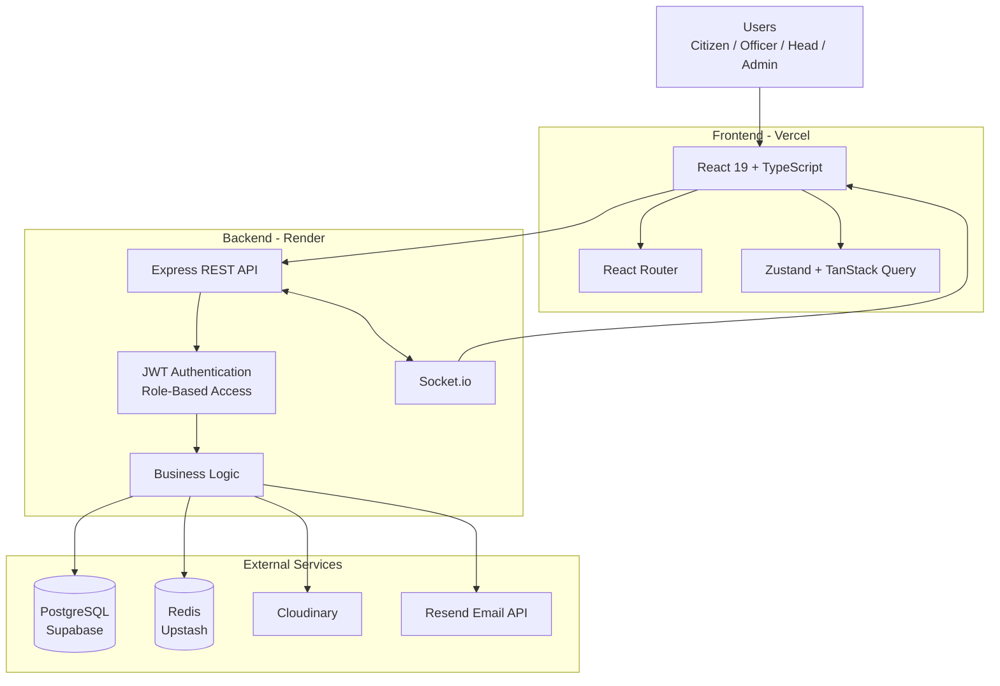

# E-Government Citizen Services Portal

A full-stack digital government platform that simplifies access to public services, streamlines citizen applications, and enables government departments to manage service requests through a centralized portal.

<p align="center">
  <a href="https://egov-portal-b151.vercel.app/">
    
  </a>
  <a href="https://egov-portal-backend.onrender.com/">
    
  </a>
  <a href="https://egov-portal-backend.onrender.com/api/docs">
    
  </a>
  
  
  
  
</p>

<p align="center">
  <a href="https://egov-portal-b151.vercel.app/">Live Application</a> •
  <a href="https://egov-portal-backend.onrender.com/api/docs">API Documentation</a> •
  <a href="#architecture">Architecture</a> •
  <a href="#screenshots">Screenshots</a>
</p>

---

## Table of Contents

- [Overview](#overview)
- [Key Features](#key-features)
- [User Roles](#user-roles)
- [Live Demo](#live-demo)
- [Demo Accounts](#demo-accounts)
- [Screenshots](#screenshots)
- [Architecture](#architecture)
- [Technology Stack](#technology-stack)
- [Project Structure](#project-structure)
- [Getting Started](#getting-started)
- [Environment Variables](#environment-variables)
- [API Documentation](#api-documentation)
- [Testing](#testing)
- [Database Management](#database-management)
- [Deployment](#deployment)
- [Security Considerations](#security-considerations)
- [Project Status](#project-status)
- [License](#license)

---

## Overview

The **E-Government Citizen Services Portal** is a full-stack web application designed to digitize public service delivery and improve communication between citizens and government departments.

Citizens can explore available services, submit applications, upload supporting documents, and track request progress. Government employees can review applications, manage departmental workflows, and monitor platform activity according to their assigned roles.

The platform is built with a modern React frontend and a Node.js backend, supported by PostgreSQL, Redis, and real-time communication.

## Key Features

### Authentication and Authorization
- User registration and login.
- JWT-based authentication.
- Refresh token management.
- Role-based access control (RBAC).
- Protected frontend routes and backend endpoints.
- Password recovery through email verification links.

### Citizen Services
- Browse available government services.
- Submit service applications.
- Upload supporting documents.
- Track submitted requests.
- View application statistics.
- Receive notifications.

### Department Management
- Manage government departments.
- Assign services to departments.
- Support departmental workflows.
- Manage officer and department-head roles.

### Administration
- Manage users and roles.
- Manage departments and services.
- Monitor system activity.
- Access administrative functionality.

### Additional Capabilities
- PostgreSQL database with Prisma ORM.
- Redis integration.
- Real-time communication using Socket.io.
- Cloudinary file storage.
- Swagger API documentation.
- Input validation and error handling.
- Audit logging.

---

## User Roles

The application supports four main roles with different access permissions.

| Role | Main Responsibilities |
|---|---|
| Citizen | Browse services, submit applications, upload documents, and track requests |
| Officer | Review and process citizen applications |
| Department Head | Oversee departmental operations and requests |
| Administrator | Manage users, departments, services, and platform operations |

---

## Live Demo

| Component | Platform | Link |
|---|---|---|
| Frontend Application | Vercel | [Open Application](https://egov-portal-b151.vercel.app/) |
| Backend API | Render | [Open Backend](https://egov-portal-backend.onrender.com/) |
| API Documentation | Swagger | [Explore API](https://egov-portal-backend.onrender.com/api/docs) |

**Note:** The backend may take some time to respond after an idle period, depending on the hosting service.

---

## Demo Accounts

The application supports four role-based account types.

To make the project easy to evaluate, dedicated demo accounts should be created for each role.

| Role | Demo Email | Password |
|---|---|---|
| Citizen | `ADD_CITIZEN_DEMO_EMAIL` | `ADD_DEMO_PASSWORD` |
| Officer | `ADD_OFFICER_DEMO_EMAIL` | `ADD_DEMO_PASSWORD` |
| Department Head | `ADD_HEAD_DEMO_EMAIL` | `ADD_DEMO_PASSWORD` |
| Administrator | `ADD_ADMIN_DEMO_EMAIL` | `ADD_DEMO_PASSWORD` |

**Important:** Replace these placeholders only after creating dedicated demo accounts. Never publish personal account credentials, production administrator credentials, or real user passwords.

<details>
<summary><strong>How to use the demo accounts</strong></summary>

1. Open the live application.
2. Navigate to the login page.
3. Select a demo account from the table.
4. Sign in to explore its role-specific dashboard.
5. Log out before testing another role.

</details>

---

## Screenshots

Screenshots demonstrate the actual user experience and role-based dashboards.

### Citizen Dashboard


### Admin Dashboard


### Additional Screenshots

Recommended screenshots:

| Screenshot | Suggested File |
|---|---|
| Login Page | `login.png` |
| Citizen Dashboard | `citizen-dashboard.png` |
| Available Services | `services.png` |
| Application Form | `application-form.png` |
| Request Tracking | `request-tracking.png` |
| Officer Dashboard | `officer-dashboard.png` |
| Admin Dashboard | `admin-dashboard.png` |

All screenshots should be placed inside `frontend/public` or a dedicated `docs/screenshots` directory. Update the image paths to match their actual locations.

---

## Architecture

### System Architecture

The application follows a frontend-backend architecture. The frontend communicates with the backend through REST APIs, while the backend integrates with the database, cache, file storage, and email services.



### Application Flow

1. Users access the application through the React frontend.
2. Authentication requests are sent to the Express backend.
3. The backend validates requests and applies role-based permissions.
4. Prisma communicates with PostgreSQL.
5. Redis supports caching and related backend operations.
6. Cloudinary handles file storage.
7. Resend handles transactional email delivery.
8. Socket.io provides real-time communication.

### API Architecture

The backend API is organized under:

```text
/api/v1
```

Main modules include:

- Authentication
- Users
- Departments
- Services
- Requests
- Documents
- Notifications
- Payments

---

## Technology Stack

### Frontend

| Technology | Purpose |
|---|---|
| React 19 | User interface |
| TypeScript | Type safety |
| Vite | Development and build tooling |
| Tailwind CSS | Styling |
| React Router | Client-side routing |
| TanStack Query | Server-state management |
| Zustand | Client-state management |

### Backend

| Technology | Purpose |
|---|---|
| Node.js | JavaScript runtime |
| TypeScript | Type-safe backend development |
| Express.js | REST API |
| Prisma ORM | Database access |
| PostgreSQL | Relational database |
| Redis | Caching and supporting backend operations |
| Socket.io | Real-time communication |
| JWT | Authentication |
| bcryptjs | Password hashing |
| Zod | Data validation |
| Swagger | API documentation |
| Cloudinary | File storage |
| Resend | Transactional email delivery |

### Infrastructure and Deployment

| Technology | Purpose |
|---|---|
| Docker | Containerization |
| Vercel | Frontend hosting |
| Render | Backend hosting |
| Supabase | PostgreSQL hosting |
| Upstash | Managed Redis |
| GitHub | Source control |

---

## Project Structure

```text
egov_portal/
│
├── backend/
│   ├── prisma/
│   │   ├── migrations/
│   │   ├── schema.prisma
│   │   └── seed.ts
│   │
│   ├── src/
│   ├── scripts/
│   ├── package.json
│   └── Dockerfile
│
├── frontend/
│   ├── public/
│   ├── src/
│   │   ├── components/
│   │   ├── features/
│   │   ├── pages/
│   │   ├── routes/
│   │   ├── services/
│   │   ├── stores/
│   │   └── App.tsx
│   │
│   ├── package.json
│   ├── vite.config.ts
│   └── vercel.json
│
├── docker-compose.yml
└── README.md
```

---

## Getting Started

### Prerequisites

Make sure you have installed:

- Node.js 20 or later
- npm
- Git
- Docker Desktop
- PostgreSQL (if not using Docker)

### 1. Clone the Repository

```bash
git clone https://github.com/Somaiyanoori/egov_portal.git

cd egov_portal
```

### 2. Start Infrastructure

If your Docker Compose configuration includes PostgreSQL, Redis, and Adminer:

```bash
docker-compose up -d
```

Verify running containers:

```bash
docker ps
```

### 3. Configure Backend

```bash
cd backend

npm install
```

Create a `.env` file in the backend directory and configure the required environment variables.

### 4. Generate Prisma Client

```bash
npm run prisma:generate
```

### 5. Apply Database Migrations

For local development:

```bash
npm run prisma:migrate
```

For an existing production database:

```bash
npm run prisma:migrate:deploy
```

### 6. Seed the Database

```bash
npm run prisma:seed
```

**Warning:** The current seed script deletes existing records from several tables before creating sample departments, services, and users.

Only run it against a fresh development or test database. Never run it against a production database containing real user data.

### 7. Start the Backend

```bash
npm run dev
```

Backend URL:

```text
http://localhost:3012
```

### 8. Start the Frontend

Open a second terminal:

```bash
cd frontend

npm install

npm run dev
```

Frontend URL:

```text
http://localhost:5173
```

---

## Environment Variables

The backend requires environment variables for database access, authentication, caching, file storage, email, and application configuration.

| Variable | Description |
|---|---|
| `NODE_ENV` | Application environment |
| `PORT` | Backend server port |
| `DATABASE_URL` | PostgreSQL connection string |
| `REDIS_URL` | Redis connection URL |
| `JWT_SECRET` | Access token signing secret |
| `JWT_REFRESH_SECRET` | Refresh token signing secret |
| `CLOUDINARY_CLOUD_NAME` | Cloudinary cloud name |
| `CLOUDINARY_API_KEY` | Cloudinary API key |
| `CLOUDINARY_API_SECRET` | Cloudinary API secret |
| `RESEND_API_KEY` | Resend email API key |
| `FRONTEND_URL` | Frontend application URL |
| `CORS_ORIGIN` | Allowed frontend origin |

Additional configuration may be required depending on the backend environment schema.

**Security:** Never commit real API keys, database credentials, JWT secrets, or `.env` files to GitHub.

---

## API Documentation

The backend uses Swagger for API documentation.

**Production API Documentation:**

[https://egov-portal-backend.onrender.com/api/docs](https://egov-portal-backend.onrender.com/api/docs)

**Local API Documentation:**

```text
http://localhost:3012/api/docs
```

The API follows a versioned structure:

```text
/api/v1
```

Use Swagger to explore available endpoints, request parameters, response schemas, and authentication requirements.

---

## Testing

The backend includes a testing setup using Vitest and Supertest.

Run commands from the backend directory.

### Check Environment

```bash
npm run check:env
```

### Type Check

```bash
npm run type-check
```

### Run Tests

```bash
npm test -- --run
```

### Run Tests in Watch Mode

```bash
npm run test:watch
```

### Generate Test Coverage

```bash
npm run test:coverage
```

### Build Backend

```bash
npm run build
```

### Build Docker Image

```bash
npm run docker:build
```

---

## Database Management

The project uses Prisma ORM with PostgreSQL.

Useful commands:

```bash
# Generate Prisma Client
npm run prisma:generate

# Create and apply a development migration
npm run prisma:migrate

# Apply existing migrations in production
npm run prisma:migrate:deploy

# Open Prisma Studio
npm run prisma:studio

# Seed development data
npm run prisma:seed
```

**Important:** `prisma:reset` can delete database records. Use it only for development and testing.

---

## Deployment

### Frontend - Vercel

The frontend is deployed on Vercel.

- Framework: Vite
- Root Directory: `frontend`
- Build Command: `npm run build`
- Output Directory: `dist`

The project uses a Vercel rewrite configuration to support React Router deep links.

### Backend - Render

The backend is deployed on Render.

**Build Command:**

```bash
npm install --include=dev && npx prisma generate && npm run build
```

**Start Command:**

```bash
npx prisma migrate deploy && node dist/server.js
```

Configure all required backend environment variables in the Render dashboard.

### Database - Supabase

The production PostgreSQL database is hosted on Supabase and managed through Prisma migrations.

Before applying production schema changes:

1. Review the migration.
2. Test it against a development database.
3. Back up production data.
4. Apply migrations using `prisma migrate deploy`.

### Redis - Upstash

The project uses managed Redis through Upstash.

### File Storage - Cloudinary

Cloudinary is used for uploaded application documents.

Keep Cloudinary credentials on the backend. Never expose the API secret in frontend code.

---

## Security Considerations

Security is an important part of the application.

The project includes:

- JWT-based authentication.
- Refresh token management.
- Role-based access control.
- Password hashing with bcryptjs.
- Input validation using Zod.
- Protected routes and API endpoints.
- Environment-based secret management.
- Backend-side authorization checks.

Production credentials and real user information must never be published in this repository.

---

## Project Status

The application has been deployed with:

- Frontend hosted on Vercel.
- Backend hosted on Render.
- PostgreSQL hosted on Supabase.
- Redis hosted on Upstash.
- File storage integrated with Cloudinary.
- Transactional email integrated with Resend.

Core infrastructure services have been connected and the database initialized.

Some production workflows, including Cloudinary document uploads, still require verification and testing.

---

## License

This project is licensed under the MIT License.

See the [LICENSE](LICENSE) file for details.

---

## Acknowledgments

Built with modern web technologies to make public services more accessible, organized, and efficient.

**Made for citizens, by developers who care.**
